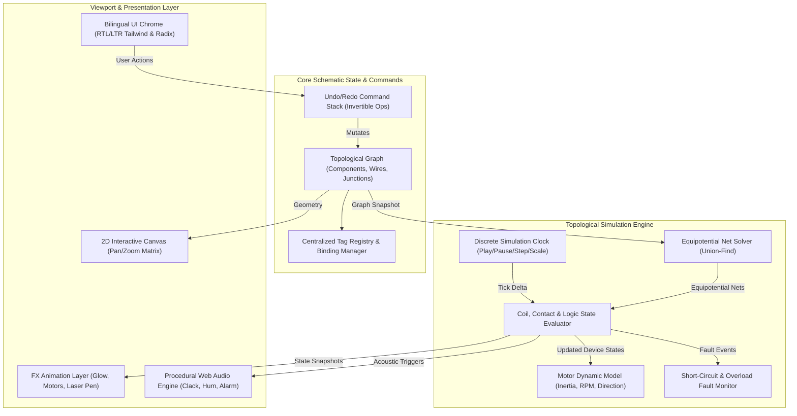

# Classic Control Desktop Simulator (Next-Gen EKTS)

*   **Author:** Mina J. Wageeh
*   **Status:** Approved
*   **Date:** 2026-11-08

--------------------------------------------------------------------------------

## Overview

The Classic Control Desktop Simulator is an interactive, bilingual (Arabic/English) desktop application for simulating, designing, and teaching industrial electromechanical motor control circuits (Classic Control). Built to replace outdated legacy tools like EKTS, it features an infinite 2D canvas, hybrid wire routing (freehand with Shift-snap to 90° orthogonal angles), automatic wire bisection branching, potential-aware glowing conductors, animated physical components (contactor armatures, rotating motor rotors with inertia, digital countdown timers), acoustic feedback, presentation tools for instructors, and a 3-tier curriculum of interactive circuits (Easy, Medium, Advanced).

## The Problem

Industrial automation students, vocational trainees, and electrical engineers in the MENA region and globally rely heavily on simulation software to learn motor control logic before touching physical three-phase switchboards. Existing legacy tools (such as EKTS, Cade SIMU, and basic relay simulators) present severe bottlenecks:
1. **Unusable Wire Editing:** Wires cannot be reshaped dynamically, right-angle routing requires frustrating manual clicks, and creating T-junction branches is clumsy or unsupported.
2. **Static & Opaque State Feedback:** Lines do not visually convey electric potential or current flow. When a circuit fails, learners cannot tell which leg is missing voltage without guessing.
3. **Missing Crucial Industrial Devices:** Lack of specialized star-delta timers, flasher relays, 6-terminal motors, thermal overloads with trip/reset toggles, and phase sequence monitors.
4. **No Pedagogical Scaffolding:** Zero context on terminal designations ($13-14$, $21-22$, $95-96$) or component functions, no Arabic interface or proper RTL text support, and no presentation tools for lecturers.
5. **No Realistic Sensory Feedback:** Lack of mechanical contactor snapping sounds, motor rotation inertia, or fault alerts.

The proposed application resolves these deficiencies with a modern desktop architecture providing sub-millimeter canvas ergonomics, instant topological wire branching, realistic physical animation and sound, contextual bilingual tooltips, a built-in virtual multimeter, and 15 curated educational circuits.

## Goals

*   **G1: Hybrid Smooth Wire Routing & Branching:** Support both organic freehand routing and Shift-locked 90° orthogonal drawing. Provide zero-friction T-junction branching by dragging onto any existing wire segment with visual snap and standard connection dots.
*   **G2: Dynamic Potential-Aware Simulation:** Implement a sub-2ms topological equipotential solver that illuminates energized conductors with distinct phase-coded luminescent glow and current-flow particle animation while keeping dead wires dark gray.
*   **G3: Multi-Sensory Physical Animations:** Animate contactor/relay armatures snapping open/shut with mechanical audio clicks, 3-phase motor rotors spinning with realistic inertia ramp-up and directional arrows, and timers displaying live digital countdown dials.
*   **G4: Comprehensive Industrial Library & Tag Binding:** Provide a rich palette of power sources, protection devices, contactors, auxiliary contacts, multi-tier timers, pushbuttons, and motors. Eliminate typo errors by binding contacts to coils via a centralized tag registry dropdown.
*   **G5: Bilingual Pedagogical & Presentation Tooling:** Offer an instant Arabic/English interface toggle, contextual hover tooltips explaining terminal functions, ephemeral laser/highlighter annotation tools for lecturers, a virtual 2-lead multimeter, and 15 interactive starter circuits across Easy, Medium, and Advanced tiers.
*   **G6: Standalone Desktop Packaging & Export:** Run completely offline as a native Windows desktop executable with project save/load (`.ccp`) and high-resolution PDF/PNG export complete with an engineering title block (cartouche).

## Non-Goals

*   **NG1: Continuous Analog SPICE Simulation:** The simulation engine deliberately excludes microsecond continuous differential equations (e.g., transient inductive kickback, arc flash physics, harmonic distortion). The focus is pure discrete logical and topological relay control.
*   **NG2: Physical 3D Cabinet / DIN-Rail Enclosure Modeling:** 3D panel layout, wire duct sizing, and terminal block DIN-rail 3D rendering are out of scope. The tool focuses on electrical schematic logic and live operational simulation.
*   **NG3: PLC Ladder Logic Programming & Compilation:** The software will not simulate programmable logic controllers (PLCs), microcontrollers, or IEC 61131-3 languages in this initial release.

## Open Questions

*   **Question 1**: Audio Engine Architecture: Procedural Web Audio API synthesizers are selected to ensure zero external binary dependencies and instant load times.
*   **Question 2**: PDF Export Pipeline: Client-side vector SVG-to-PDF rendering via `jspdf` is selected to preserve scalable vector line quality at print resolutions.

## Critical User Journeys (CUJs)

### CUJ 1: Student Builds and Tests a Direct-On-Line (DOL) Starter
*   **Given**: A blank workspace in Design Mode with grid snapping active.
*   **When**: The student places a 3-Phase power source, a 3-pole MCB, a Contactor power block ($KM_1$), a Thermal Overload ($OL_1$), and a 3-phase Induction Motor. In the control rung, they place a Start button ($S_2$), Stop button ($S_1$), Contactor Coil ($KM_1$), and an Aux NO contact ($13-14$) wired in parallel with the Start button. They drag wires, using `Shift` for clean 90° corners, and tap any wire to create branch connections. They switch to Run Mode and click Start.
*   **Then**: The coil illuminates, an audible mechanical "clack" sounds, the auxiliary contact snaps closed, maintaining the latch. The power lines glow neon amber, and the motor begins rotating clockwise with an RPM acceleration ramp.

### CUJ 2: Instructor Presents a Star-Delta Circuit with Laser Markup
*   **Given**: An instructor opens the pre-loaded "Automatic Star-Delta Starter" example from the Medium curriculum.
*   **When**: The instructor activates Presentation Mode, increases the cursor spotlight, activates the laser highlighter tool to trace the Star contactor loop on screen, and presses Run.
*   **Then**: The Main ($KM_1$) and Star ($KM_2$) contactors close; the Star-Delta timer counts down from 5.0s to 0.0s on its body. When expired, $KM_2$ drops out, an electrical interlock delay protects against arcing, and Delta ($KM_3$) engages. The motor transitions to full delta voltage smoothly while the highlighter sketch cleanly auto-fades.

### CUJ 3: Technician Uses Virtual Multimeter to Diagnose a Fault
*   **Given**: A student is practicing in Troubleshooting Mode with an injected fault in a Forward-Reverse starter.
*   **When**: The student presses the Reverse button, but the motor fails to turn. The student picks up the virtual multimeter probes, placing the Red probe on $KM_2$ terminal $A_1$ and Black probe on Neutral.
*   **Then**: The meter display reads $0\text{V AC}$. Tracing upstream, the probe touches the normally-closed interlock contact of $KM_1$ ($21-22$) and discovers that the mechanical contact is stuck open. The student replaces the contact and the circuit functions.

--------------------------------------------------------------------------------

## Technical Plan (Architecture)

### Architectural Overview

The application follows a strictly decoupled, unidirectional data architecture designed for real-time responsiveness, modularity, and high-frame-rate visual rendering.



---

### Component Subsystems

#### 1. Presentation & Viewport Subsystem
* **Dual-Tier Vector & Animation Pipeline:**
  * **Base Vector Layer (SVG & High-DPI Canvas):** Renders the infinite grid, component IEC symbols, terminal connection circles (radii $4\text{px}$, hover snap $10\text{px}$), and wire geometry.
  * **Dynamic FX & Glow Layer:** Runs at 60+ FPS using an offscreen canvas.
    * *Energized Conductor Luminescence:* Applies dynamic multi-pass Gaussian blur glow filters colored by phase potential ($L_1, L_2, L_3, N, PE$).
    * *Current Flow Particle Emitter:* Moves discrete luminescence dashes along conductive paths in the direction of current flow.
    * *Armature Mechanical Snap:* Renders contactor contacts moving from normal to actuated positions over a 60ms spring-damped trajectory.
    * *Motor Dynamics:* Draws a stylized 3-phase rotor with rotating cooling fan blades, phase-sequence directional indicator, and real-time RPM speedometer badge.
  * **Presentation / Lecture Overlay Layer:**
    * Ephemeral pointer canvas where lecturers draw freehand current loops using a neon highlighter or laser pointer. Strokes undergo exponential alpha decay ($t_{\text{fade}} = 2.5\text{s}$) or clear instantly on button press.
    * Spotlight cursor magnifying terminal designations during projection.

#### 2. Topological Schematic Graph Model (`NetGraph`)
* **Data Structures:**
  * `Terminal`: Represents a physical connection pin on a component.
    ```typescript
    interface Terminal {
      id: string;
      componentId: string;
      pinIndex: number;
      label: string; // e.g., '13', '14', 'A1', 'A2', '95', '96'
      position: { x: number; y: number };
      netId: string | null;
      potential: VoltagePotential; // 'L1' | 'L2' | 'L3' | 'N' | 'PE' | 'DC+' | 'DC-' | 'NONE'
    }
    ```
  * `JunctionNode`: Represents a T-branch connection point along a wire.
    ```typescript
    interface JunctionNode {
      id: string;
      position: { x: number; y: number };
      wireIds: string[];
      netId: string | null;
    }
    ```
  * `Wire`: Encapsulates a conductive route between terminals and/or junctions.
    ```typescript
    interface Wire {
      id: string;
      from: { type: 'terminal' | 'junction'; id: string };
      to: { type: 'terminal' | 'junction'; id: string };
      waypoints: { x: number; y: number }[];
      routingMode: 'free' | 'ortho';
      netId: string | null;
    }
    ```
  * `Component`: Encapsulates device attributes, electrical ratings, and state.
    ```typescript
    interface DeviceComponent {
      id: string;
      type: ComponentType; // 'coil' | 'main_contact' | 'aux_no' | 'aux_nc' | 'motor_3p' | ...
      tag: string; // e.g., 'KM1', 'S1', 'OL1'
      masterId?: string; // Links dependent contact to master coil or overload
      position: { x: number; y: number };
      rotation: 0 | 90 | 180 | 270;
      terminals: Terminal[];
      state: DeviceState; // { energized: boolean; closed: boolean; tripped: boolean; ... }
    }
    ```
* **Wire Bisection & Instant Branching Algorithm:**
  * When a user drags a new wire end within $\epsilon_{\text{snap}} = 10\text{px}$ of an existing wire segment $\overline{AB}$:
    1. Calculate orthogonal projection point $P_{\text{proj}} = \text{proj}(P_{\text{cursor}}, \overline{AB})$.
    2. Spawn a new `JunctionNode` at $P_{\text{proj}}$.
    3. Bisect wire $\overline{AB}$ into $\overline{A P_{\text{proj}}}$ and $\overline{P_{\text{proj}} B}$.
    4. Terminate the new wire at $P_{\text{proj}}$.
    5. Register all three wire edges under the same electrical net.

#### 3. Simulation & Topological Logic Engine
* **Equipotential Net Solver (Union-Find):**
  * Rather than costly continuous numerical matrices, the solver treats the circuit as a conductive graph where closed switches, closed contactors, closed overload contacts, and wires act as zero-impedance edges.
  * An optimized Union-Find (Disjoint-Set with path compression) groups all connected terminals and junctions into disjoint equipotential sets.
  * Source terminals ($L_1, L_2, L_3, N, PE$) assign potentials to their respective root sets.
* **Device State Evaluator & Cycle Propagation:**
  * Once net potentials are resolved, coils ($A_1-A_2$) check for potential differences (e.g., $V(A_1) = L_1$ and $V(A_2) = N$).
  * If potential difference is present, the coil enters the `energized` state.
  * The evaluator consults the `TagRegistry` and updates all linked auxiliary contacts (NO contacts transition to closed; NC contacts transition to open).
  * If any contact changes state, the Union-Find solver re-evaluates the circuit. A cycle threshold (maximum 10 iterations) prevents infinite loops in unstable feedback networks.
* **Direct Short-Circuit Protection:**
  * If the solver assigns two conflicting source potentials to the same equipotential net (e.g., $L_1$ and $N$, or $L_1$ and $L_2$ directly connected through a closed contact with no load impedance), a `ShortCircuitFault` event is emitted:
    * Upstream miniature circuit breaker (MCB) trips to open.
    * A visual arc flash alert illuminates the faulted branch.
    * The simulation halts until the fault is corrected.
* **Motor Dynamic & Phase-Sequence Model:**
  * A 3-phase induction motor monitors terminals $U_1, V_1, W_1$:
    * If energized with valid phase sequence ($L_1-L_2-L_3$), direction is Clockwise ($+1$).
    * If any two phases are transposed ($L_2-L_1-L_3$), direction is Counter-Clockwise ($-1$).
    * If one phase is lost, motor enters single-phasing fault (stalls with increased current and overload heating).
  * Dynamic rotation accelerates smoothly according to rotor inertia:
    $$\omega(t + \Delta t) = \omega(t) + \left(\frac{T_e - T_{\text{load}}}{J}\right) \Delta t$$

#### 4. Procedural Acoustic Engine
* Built with the Web Audio API without requiring bulky external audio assets:
  * **Contactor Snap:** High-frequency burst of white noise filtered through an envelope-controlled biquad bandpass filter ($f_c = 1.2\text{kHz}, Q = 8$) with rapid $25\text{ms}$ decay, mimicking spring armature impact.
  * **Motor Hum:** Dual sine wave oscillators (50Hz fundamental + 150Hz third harmonic) modulated by a gentle random gain jitter, frequency-scaled by current motor RPM.
  * **Alarm Buzzer:** Piezo-style square wave oscillator ($2.4\text{kHz}$) modulated by a $2\text{Hz}$ pulse train.
  * Master volume slider and instant mute toggle on the top toolbar.

#### 5. Project Schema & Serialization (`.ccp`)
* Clean JSON schema with versioning:
  ```json
  {
    "version": "1.0.0",
    "metadata": {
      "title": "Star-Delta Motor Starter",
      "author": "Mina J. Wageeh",
      "date": "2026-11-08",
      "language": "ar",
      "standard": "IEC"
    },
    "viewport": { "panX": 150, "panY": 80, "zoom": 1.0 },
    "components": [],
    "wires": [],
    "junctions": []
  }
  ```

--------------------------------------------------------------------------------

## Alternatives Considered

### Alternative 1: Full Schematic Canvas RTL Coordinate Mirroring
*   **Pros**: Complete bidirectional symmetry with Arabic UI layout (all panels and canvases oriented from right to left).
*   **Cons**: Directly violates international electrotechnical standards (IEC 60617, NFPA 79, DIN EN 61082) where power rungs flow strictly Top-to-Bottom ($L_1, L_2, L_3 \to \text{Motor}$) and control rungs flow Left-to-Right ($L \to \text{Stop} \to \text{Start} \to \text{Coil} \to N$). Inverting the canvas coordinates creates non-standard schematics that disorient technicians transitioning to real-world industrial machinery.
*   **Reason for Rejection**: Rejected by author: The schematic canvas must strictly uphold international industrial conventions (Top-to-Bottom, Left-to-Right), while UI chrome, sidebars, and contextual cards adapt to the active locale (Arabic RTL or English LTR).

### Alternative 2: Continuous Analog SPICE Differential Equation Solver
*   **Pros**: Capable of simulating microsecond inductive coil flyback spikes, harmonic distortions, and contact bounce phenomena.
*   **Cons**: Introduces high CPU and memory overhead, numerical matrix non-convergence crashes, and unpredictable latencies that degrade UI responsiveness below 60 FPS. Electromechanical relay control operates primarily on discrete conducting vs. non-conducting binary states.
*   **Reason for Rejection**: Rejected by author: A discrete topological graph propagation engine (Union-Find) resolves complete circuits deterministically in $< 2\text{ms}$, avoids numerical convergence failures, and provides instantaneous visual feedback.

### Alternative 3: Free-Text Tag Typing for Contact-to-Coil Association
*   **Pros**: Minimal UI complexity during early prototype development.
*   **Cons**: High user error rate due to typographical inconsistencies (e.g., typing `Km1` or `KM-1` instead of `KM1`), which silently breaks electrical interlocking and latching logic without visual explanation.
*   **Reason for Rejection**: Rejected by author: A centralized tag registry with instant dropdown selection and bidirectional cross-canvas highlighting guarantees referential integrity and eliminates typing errors.

### Alternative 4: Static Pre-recorded Audio Files (WAV/MP3)
*   **Pros**: Simple integration using basic HTML5 `<audio>` playback elements.
*   **Cons**: Increases binary bundle size, introduces asset decoding latencies, and prevents dynamic modulation of motor pitch and harmonics in response to real-time rotational acceleration.
*   **Reason for Rejection**: Rejected by author: Procedural Web Audio API synthesis has zero binary asset footprint, zero loading latency, and enables continuous dynamic frequency modulation tied to rotor RPM.

--------------------------------------------------------------------------------

## Detailed Implementation Plan

The project will be built as a high-performance desktop application using **Electron + Vite + React 19 + TypeScript + Tailwind CSS**. Below is the exhaustive file-by-file specification of all modules to be created.

### Target Files to Create

#### 1. Build, Shell & Packaging Configuration
*   **`package.json`** (`Create`)
    *   *Scope*: Project manifest, scripts (`dev`, `build`, `electron:dev`, `electron:build`), and dependencies (`react`, `react-dom`, `lucide-react`, `tailwindcss`, `electron`, `vite`, `jspdf`, `canvas-confetti`).
    *   *Rationale*: Defines the application dependencies, build scripts, and Electron desktop packaging configurations.
*   **`vite.config.ts`** (`Create`)
    *   *Scope*: Vite build configuration supporting React, Electron preload/main integration, and asset optimization.
    *   *Rationale*: Ensures fast HMR (Hot Module Replacement) during development and optimized single-bundle output for the Electron desktop shell.
*   **`tsconfig.json` & `tsconfig.node.json`** (`Create`)
    *   *Scope*: Strict TypeScript configuration with ES2022 target, React JSX, and strict null checking.
    *   *Rationale*: Enforces type safety across the topological graph solver and UI state machines.
*   **`tailwind.config.js` & `postcss.config.js`** (`Create`)
    *   *Scope*: Tailwind CSS setup with custom dark industrial palette (slate, amber, copper, neon glow effects) and RTL support.
    *   *Rationale*: Provides rapid, responsive styling for bilingual desktop UI chrome.
*   **`electron/main.ts`** (`Create`)
    *   *Scope*: Electron main process. Initializes BrowserWindow with hardware acceleration, native menus, IPC handlers for file operations (open/save `.ccp`), PDF generation, and window controls.
    *   *Rationale*: Manages the native OS desktop lifecycle and privileged system I/O.
*   **`electron/preload.ts`** (`Create`)
    *   *Scope*: Context bridge exposing safe, typed APIs to the renderer process (`window.electronAPI.saveFile`, `openFile`, `exportPdf`).
    *   *Rationale*: Enforces Electron security best practices (contextIsolation enabled, nodeIntegration disabled).

#### 2. Core Topological Graph & Command History
*   **`src/core/types/circuit.ts`** (`Create`)
    *   *Scope*: TypeScript definitions for `Terminal`, `JunctionNode`, `Wire`, `DeviceComponent`, `VoltagePotential`, `Net`, and `CircuitProject`.
    *   *Rationale*: Central domain model shared between the UI viewport, topological solver, and file serializer.
*   **`src/core/types/components.ts`** (`Create`)
    *   *Scope*: Definitions of all catalog components: power sources (1P/3P/DC), circuit breakers (MCB 1P/3P), contactor power blocks, auxiliary contacts (NO 13-14, NC 21-22), thermal overload relays (95-96/97-98), timers (On-Delay, Off-Delay, Flasher, Star-Delta), pushbuttons, selector switches, limit switches, and motors (1P, 3P 3-wire, 3P 6-wire).
    *   *Rationale*: Standardizes pin mappings, electrical ratings, and default tags across the application.
*   **`src/core/graph/NetGraph.ts`** (`Create`)
    *   *Scope*: Graph state container. Methods for adding/removing components, routing wires, bisecting wires at junctions, batch moving, rotating, and querying connected neighbors.
    *   *Rationale*: Encapsulates the schematic topological network independently of UI rendering.
*   **`src/core/graph/TagRegistry.ts`** (`Create`)
    *   *Scope*: Tag binding manager. Tracks master coils/relays/overloads (`KM1`, `KA1`, `KT1`, `OL1`) and maps dependent contacts. Emits change events when tags are rebound.
    *   *Rationale*: Ensures referential integrity between remote contacts and coils, eliminating manual typographical bugs.
*   **`src/core/commands/CommandManager.ts`** (`Create`)
    *   *Scope*: Command Pattern stack implementing invertible commands (`AddComponentCommand`, `MoveComponentsCommand`, `AddWireCommand`, `SplitWireCommand`, `DeleteSelectionCommand`).
    *   *Rationale*: Provides multi-level Undo/Redo (`Ctrl+Z` / `Ctrl+Y`) and transaction grouping for batch operations.

#### 3. Simulation & Topological Logic Engine
*   **`src/simulation/solver/UnionFind.ts`** (`Create`)
    *   *Scope*: Optimized Disjoint-Set data structure with rank balancing and path compression.
    *   *Rationale*: Delivers near $O(1)$ amortized partition calculation for electrical equipotential nets.
*   **`src/simulation/solver/EquipotentialSolver.ts`** (`Create`)
    *   *Scope*: Solves potential distribution. Merges connected conductive edges (closed switches, closed contacts, wires) into nets and propagates source voltages ($L_1, L_2, L_3, N, PE, +24\text{V}, 0\text{V}$).
    *   *Rationale*: Core engine that determines live vs. dead conductors in $< 2\text{ms}$.
*   **`src/simulation/evaluators/DeviceEvaluator.ts`** (`Create`)
    *   *Scope*: Evaluates electromechanical states: calculates coil activation from terminal potential differences, updates auxiliary contacts, drives timer countdown logic, and evaluates breaker states with feedback iteration bounds.
    *   *Rationale*: Bridges the gap between static graph connectivity and dynamic relay ladder logic.
*   **`src/simulation/evaluators/MotorDynamics.ts`** (`Create`)
    *   *Scope*: Dynamic model for 3-phase and 1-phase motors. Analyzes applied phase sequence ($U-V-W$) to determine direction (CW vs. CCW), simulates rotational inertia, computes RPM, and detects single-phasing stalls.
    *   *Rationale*: Provides realistic physical motor behaviors and visual gauges.
*   **`src/simulation/clock/SimulationClock.ts`** (`Create`)
    *   *Scope*: Centralized simulation clock supporting play, pause, single-step ticks, and speed multipliers ($0.25\times, 0.5\times, 1.0\times, 2.0\times$).
    *   *Rationale*: Ensures timers and dynamic animations behave deterministically regardless of display refresh rate.
*   **`src/simulation/faults/FaultManager.ts`** (`Create`)
    *   *Scope*: Monitors for dead short-circuits (e.g., Phase-to-Neutral or Phase-to-Phase without load) and automatically trips upstream protection. Manages injected diagnostic faults for educational exercises.
    *   *Rationale*: Protects simulation stability and powers the troubleshooting training mode.

#### 4. Procedural Acoustic Engine
*   **`src/audio/AudioEngine.ts`** (`Create`)
    *   *Scope*: Web Audio API procedural synthesizer: synthesizes contactor armature snaps via filtered impulse bursts, motor hum with RPM-scaled harmonic oscillators, and alarm siren tones. Includes volume control and mute toggles.
    *   *Rationale*: Delivers tactile, realistic industrial acoustic feedback with zero external sound file dependencies.

#### 5. Interactive 2D Viewport & Visual Renderers
*   **`src/canvas/CanvasViewport.tsx`** (`Create`)
    *   *Scope*: Main infinite 2D canvas viewport. Manages pan/zoom transformation matrices ($T \in SE(2)$), grid rendering, marquee selection box, and mouse event routing.
    *   *Rationale*: The interactive primary stage for designing and running circuits.
*   **`src/canvas/renderers/WireRenderer.ts`** (`Create`)
    *   *Scope*: Renders freehand and 90° orthogonal wires, junction dots ($\bullet$), non-connected crossing jumper arcs, and dynamic multi-pass glow shaders on energized conductors.
    *   *Rationale*: Provides clean, aesthetically pleasing, and technically accurate wire graphics.
*   **`src/canvas/renderers/ComponentRenderer.tsx`** (`Create`)
    *   *Scope*: Vector SVG/Canvas renderer for all IEC 60617 electrical symbols, terminal pin halos, and animated contact armatures.
    *   *Rationale*: Ensures crisp rendering at any zoom scale with spring-damped contact closure animations.
*   **`src/canvas/renderers/MotorRenderer.tsx`** (`Create`)
    *   *Scope*: Dedicated component renderer for electric motors: animated spinning rotor disc, cooling fan blades, direction arrows, and RPM readout badge.
    *   *Rationale*: Visually communicates motor running state, speed, and rotational direction.
*   **`src/canvas/renderers/LaserOverlay.tsx`** (`Create`)
    *   *Scope*: Ephemeral canvas overlay for lecturers. Supports drawing temporary fluorescent highlighter paths with exponential alpha fading and a spotlight cursor.
    *   *Rationale*: Empowers instructors to trace live electrical paths dynamically during classroom presentations.
*   **`src/canvas/tools/MultimeterTool.tsx`** (`Create`)
    *   *Scope*: Virtual multimeter HUD with draggable Red and Black probes. Calculates true potential difference and continuity between any two probed terminals.
    *   *Rationale*: Essential pedagogical tool for teaching hands-on electrical troubleshooting.

#### 6. UI Chrome, Localization & Dialogs
*   **`src/components/layout/AppHeader.tsx`** (`Create`)
    *   *Scope*: Top navigation bar containing Mode Toggle (Design vs. Run), Sim Clock controls (Play, Pause, Step, Speed), Undo/Redo, Language Toggle (AR/EN), Audio Toggle, Presentation Tools, and Export triggers.
    *   *Rationale*: Central operational hub for the application.
*   **`src/components/layout/SidebarPalette.tsx`** (`Create`)
    *   *Scope*: Accordion-based component library drawer with search filter and category sub-menus (Power, Protection, Contactors, Timers, Switches, Loads).
    *   *Rationale*: Enables rapid drag-and-drop or click-to-place component insertion.
*   **`src/components/layout/PropertiesInspector.tsx`** (`Create`)
    *   *Scope*: Side panel displaying selected component properties: tag, master coil binding dropdown, ratings, timer presets, and terminal status.
    *   *Rationale*: Provides seamless editing of component parameters and tag associations.
*   **`src/components/overlays/ComponentTooltip.tsx`** (`Create`)
    *   *Scope*: Contextual hover card presenting component name, IEC symbol, primary industrial function, terminal numbering breakdown, and real-time operational status in Arabic or English.
    *   *Rationale*: Fulfills the pedagogical requirement for simplified contextual explanations on hover.
*   **`src/components/dialogs/ExamplesDialog.tsx`** (`Create`)
    *   *Scope*: Modal dialog cataloging 15 pre-built educational circuits categorized into Easy, Medium, and Advanced tiers, complete with circuit descriptions and 1-click loading.
    *   *Rationale*: Gives students and teachers immediate access to verified, working motor control circuits.
*   **`src/components/dialogs/ExportDialog.tsx`** (`Create`)
    *   *Scope*: Dialog for exporting schematics to high-resolution PNG or vector PDF, allowing customization of the engineering Title Block (Cartouche).
    *   *Rationale*: Enables students to submit homework and engineers to export professional wiring diagrams.
*   **`src/i18n/translations.ts`** (`Create`)
    *   *Scope*: Complete bilingual translation dictionary (English and Arabic with proper technical terminology) for all UI labels, tooltips, and component descriptions.
    *   *Rationale*: Guarantees seamless bilingual switching without mixed-language artifacts.

#### 7. Pre-built Educational Circuit Templates
*   **`src/examples/easyCircuits.ts`** (`Create`)
    *   *Scope*: Pre-configured schematic schemas for: 1. Direct-On-Line (DOL) Starter, 2. Two-Station Start/Stop, 3. Inching/Jogging Circuit, 4. On-Delay Motor Starter.
    *   *Rationale*: Foundation circuits for learning basic start/stop, latching, and overload protection.
*   **`src/examples/mediumCircuits.ts`** (`Create`)
    *   *Scope*: Pre-configured schemas for: 1. Forward/Reverse with Electrical & Pushbutton Interlocks, 2. Automatic Star-Delta Starter with transition timer, 3. Sequential Motor Starting (2 Motors), 4. Automatic Tank Level Control (Float switch + HOA selector), 5. Periodic Flashing Alarm.
    *   *Rationale*: Standard industrial control circuits widely taught in technical institutes.
*   **`src/examples/advancedCircuits.ts`** (`Create`)
    *   *Scope*: Pre-configured schemas for: 1. Dahlander Two-Speed Motor Starter, 2. Reversible Star-Delta Starter (5 contactors), 3. Alternating Lead-Lag Dual Pumps, 4. Automated Conveyor with Limit Switches, 5. Cascading Traffic Light Controller.
    *   *Rationale*: Advanced industrial automation circuits demonstrating complex interlocking and sequencing.

#### 8. Verification & Test Suite
*   **`tests/unit/solver.test.ts`** (`Create`)
    *   *Scope*: Unit tests for the Union-Find equipotential solver: verifies potential propagation across series/parallel switches, latching circuit stability, and short-circuit fault emission.
    *   *Rationale*: Guarantees mathematical and logical correctness of the circuit simulation.
*   **`tests/unit/graph.test.ts`** (`Create`)
    *   *Scope*: Unit tests for the `NetGraph` model: verifies wire bisection, T-junction spawning, component removal cascade, and Undo/Redo consistency.
    *   *Rationale*: Prevents regressions in wire routing and graph integrity.
*   **`tests/unit/motor.test.ts`** (`Create`)
    *   *Scope*: Tests for phase-sequence motor logic: verifies clockwise rotation for $L_1-L_2-L_3$, counter-clockwise for $L_2-L_1-L_3$, and stall condition for single-phasing.
    *   *Rationale*: Ensures motor direction and fault dynamics behave accurately.

### Verification Plan

*   **Compilation & Build**:
    *   Run `npm run build` to verify clean TypeScript compilation and Vite bundle generation with zero warnings or errors.
*   **Unit Tests**:
    *   Run `npm test` to execute all unit tests in `tests/unit/`, validating the graph solver, wire splitting geometry, and motor dynamics with 100% pass rate.
*   **Manual & Visual Verification**:
    *   Launch development preview with `npm run dev` and `npm run electron:dev`.
    *   Verify infinite pan/zoom and grid alignment.
    *   Draw wires in freehand mode, then hold `Shift` to confirm 90° orthogonal constraint.
    *   Drag a wire end to bisect an existing line and confirm automatic insertion of a solid junction dot ($\bullet$).
    *   Load the DOL Starter example, switch to Run Mode, press Start: verify coil illumination, contactor click sound, auxiliary contact snap, wire glow, and smooth motor rotation.
    *   Toggle Language between Arabic and English: confirm full UI chrome and tooltip translation with preserved schematic orientation.
    *   Verify presentation laser highlighter drawing and auto-fade.

--------------------------------------------------------------------------------

*Drafted with EGM*
